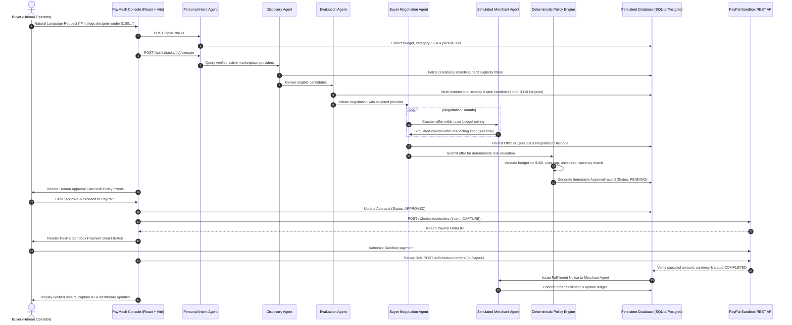

# PayMesh — AI Agent Commerce Network

<div align="center">

```
  ____               __  __           _     
 |  _ \ __ _ _   _  |  \/  | ___  ___| |__  
 | |_) / _` | | | | | |\/| |/ _ \/ __| '_ \ 
 |  __/ (_| | |_| | | |  | |  __/\__ \ | | |
 |_|   \__,_|\__, | |_|  |_|\___||___/_| |_|
             |___/                          
```

### **“Connect Intelligence. Transact Trustfully.”**

[](LICENSE)
[](https://python.org)
[](https://fastapi.tiangolo.com)
[](https://react.dev)
[](https://vitejs.dev)
[](https://tailwindcss.com)
[](https://developer.paypal.com)

</div>

---

## 1. Executive Summary & Problem Statement

### The Problem
Traditional e-commerce forces users to manually compare dozens of service providers, read pages of reviews, haggle over deliverables, and repeatedly enter payment details. Meanwhile, emerging AI agents often lack **financial guardrails**, risking catastrophic prompt-injection exploits, unauthorized charges, or hallucinations where non-existent providers receive funds.

### The PayMesh Solution
**PayMesh** is an autonomous multi-agent commerce network that delegates discovery, provider evaluation, and price negotiation to intelligent AI agents, while enforcing **deterministic policy gates** and **mandatory human authorization** before executing payment capture via **PayPal Sandbox Orders v2**.

PayMesh demonstrates true **agent-to-agent coordination**, rather than a superficial chatbot with a payment button.

---

## 2. System Architecture & Workflow



---

## 3. Multi-Agent Ecosystem

| Agent Name | Architectural Role | Execution Nature |
| :--- | :--- | :--- |
| **Personal Intent Agent** | Extracts structured constraints (`service_category`, `max_budget`, `deadline_days`, `min_rating`) from natural language. | AI / Structured Pydantic |
| **Marketplace Discovery Agent** | Searches database records. Enforces hard eligibility filters (category match, availability, ratings). Never invents providers. | Deterministic DB Query |
| **Evaluation Agent** | Scores providers across 5 dimensions: Relevance (30%), Ratings (25%), Budget (20%), Speed (15%), Verification (10%). | Multi-Factor Algorithmic |
| **Buyer Negotiation Agent** | Strategizes bids, drives counteroffers against buyer budget cap, records full round logs. | Autonomous Reasoning |
| **Simulated Merchant Agent** | Evaluates bids against provider's internal reservation floor price (`minimum_price`). Protects seller margins. | Simulated Autonomous Vendor |
| **Deterministic Policy Engine** | **The Security Bastion.** Asserts budget caps, user transaction limits, currency consistency, and duplicate payment prevention. | **Strict Python Rules (No AI)** |
| **Human Supervisor Gate** | Final authority. Binds cryptographic authorization to exact offer version, currency, and amount. | Human-in-the-Loop |

---

## 4. Technology Stack

- **Frontend**: React 18, Vite 6, TypeScript, Tailwind CSS, Lucide Icons, React Router v7.
- **Backend**: Python 3.13, FastAPI, Pydantic v2, SQLAlchemy 2.x, SQLite (zero-setup Windows) / PostgreSQL.
- **Security**: JWT (`pyjwt`), password hashing (`bcrypt`), server-side policy authorization.
- **Payments**: PayPal REST API (OAuth 2.0, Orders v2 `CAPTURE`, JavaScript SDK checkout, Webhooks).
- **Testing**: `pytest`, `pytest-asyncio`, `pytest-mock`, FastAPI `TestClient`.

---

## 5. Quick Start (Windows & Cross-Platform)

### Prerequisites
- Python 3.10+ (Tested on Python 3.13)
- Node.js 18+ and npm
- (Optional) Docker for PostgreSQL

### Option A: One-Command Windows PowerShell Launch
```powershell
# 1. Clone repository
git clone https://github.com/your-username/paymesh.git
cd paymesh

# 2. Launch concurrent dev environment
.\scripts\dev.ps1
```

### Option B: Manual Step-by-Step

#### 1. Backend Setup
```powershell
cd backend
python -m venv .venv
.\.venv\Scripts\pip install -r requirements.txt

# Seed rich marketplace providers & demo operator (demo@paymesh.ai / password123)
.\.venv\Scripts\python seed.py

# Launch FastAPI backend
.\.venv\Scripts\uvicorn app.main:app --reload --port 8000
```
- API is running at: `http://localhost:8000`
- Interactive Swagger docs: `http://localhost:8000/docs`

#### 2. Frontend Setup
```powershell
cd ..\frontend
npm install
npm run dev
```
- Web Application is running at: `http://localhost:5173`

---

## 6. The 3-Minute Master Hackathon Demo

Follow this exact workflow to demonstrate all PayMesh capabilities:

1. **Sign In**: Navigate to `http://localhost:5173/login`. Click **"Fill Demo"** (`demo@paymesh.ai` / `password123`) and click **Sign In**.
2. **Launch AI Workspace**: Navigate to **AI Workspace** from the top bar.
3. **Insert Demo Prompt**: Click the button **"Insert 3-Min Master Demo Prompt"**:
   > *"Find me a professional logo designer for my startup. My maximum budget is $100, delivery must be within 3 days, and I prefer providers rated above 4.5. Negotiate the best reasonable price and ask me before making any payment."*
4. **Execute Pipeline**: Click **Execute Pipeline**.
   - Watch the live **Agent Activity Timeline** record steps.
   - Observe **Discovery Agent** finding eligible candidates.
   - Observe **Evaluation Agent** selecting *NovaStudio Branding* with composite score 93/100.
   - Observe **Negotiation Agent** negotiating initial **$110.00** catalog price down to **$98.00** across 4 rounds.
   - Observe **Policy Engine** running 6 deterministic risk assertions (`PASS`).
5. **Human Sign-Off**: Inspect the **Human Approval Gate**. Click **"Approve Transaction ($98.00) & Unlock PayPal"**.
6. **PayPal Sandbox Checkout**:
   - Click **"Launch PayPal Sandbox Order ($98.00)"**.
   - Review server-side order generation (`ORDER ID`).
   - Click **"Simulate Buyer Sign-Off & Capture Order"**.
7. **Order Fulfilled**:
   - Observe real server-side capture verification.
   - Observe **Simulated Merchant Agent** acknowledgment and delivery kickoff.
8. **Audit Trail**: Navigate to **Transactions** and **Dashboard** to see updated real-time savings ($12.00 saved), captured sandbox volume, and chronological ledger entries!

---

## 7. Testing Suite

Run the full automated test suite (all 9 unit & integration suites):

```powershell
# From project root:
.\backend\.venv\Scripts\pytest -v
```

Tests cover:
- Intent extraction & regex/entity extraction
- Database candidate discovery & ranking algorithms
- Multi-round negotiation price floor assertions
- Deterministic policy engine checks (budget ceiling, currency, provider verification)
- User access isolation (no cross-tenant leakage)
- PayPal order generation & capture workflows
- Webhook signature validation and duplicate idempotency

---

## 8. PayPal Sandbox Configuration

In `backend/.env` (or root `.env`):
```env
PAYPAL_MODE=sandbox
PAYPAL_CLIENT_ID=your_sandbox_client_id
PAYPAL_CLIENT_SECRET=your_sandbox_client_secret
PAYPAL_WEBHOOK_ID=your_webhook_id
```

> **Zero-Config Demo Mode:** If credentials are not specified, PayMesh automatically operates in an intelligent **Deterministic High-Fidelity Simulation Mode** with `MOCK-SANDBOX-` identifiers, enabling instant offline testing for hackathon evaluators without requiring API keys!

---

## 9. Security Principles

1. **Deterministic Financial Authorization**: AI models never have write access to user funds or the ability to bypass policy ceilings.
2. **Backend-Only Secrets**: PayPal Client Secret and OAuth tokens reside strictly on the server and are never exposed to the client bundle.
3. **Idempotency & Duplicate Guards**: Both the payment service and webhook listeners reject duplicate requests using cryptographic and database uniqueness constraints.
4. **Tenant Isolation**: Tasks, offers, approvals, and transaction records enforce strict database-level user ownership checks.

---

## 10. Open-Source License

This project is licensed under the **MIT License** — see the [LICENSE](LICENSE) file for details.
