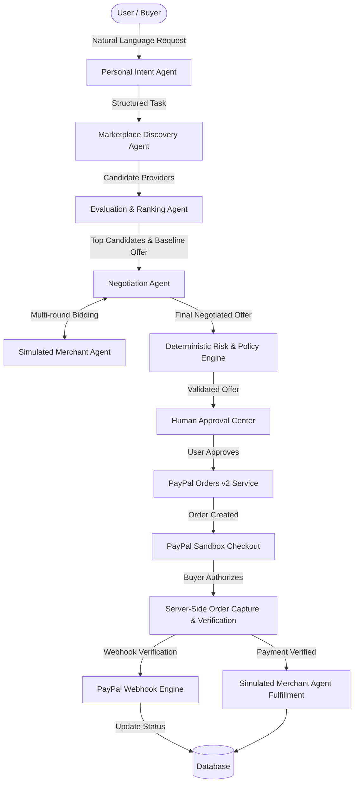

# PayMesh — Architecture & Specifications

> **Tagline:** Connect Intelligence. Transact Trustfully.  
> **Category:** AI Agent Commerce Network  
> **Payment Core:** PayPal Sandbox Orders v2 & Webhooks  

---

## 1. System Overview

PayMesh is an autonomous multi-agent commerce network that delegates discovery, evaluation, price negotiation, and checkout preparation to coordinated AI agents, while enforcing deterministic financial guardrails and explicit human approval before any transaction occurs via PayPal.

---

## 2. Multi-Agent Ecosystem

1. **Personal Intent Agent**:
   - Parses unstructured natural language requests into typed Pydantic task definitions.
   - Extracts service category, maximum budget, target currency, deadline, and quality criteria.
   - Prompts for missing essentials when ambiguous.

2. **Discovery Agent**:
   - Executes parameterized queries against the verified provider marketplace.
   - Enforces hard eligibility filters (rating threshold, delivery capability, category matching).

3. **Evaluation Agent**:
   - Scores candidates across 5 weighted dimensions:
     - Service Relevance (30%)
     - Historical Provider Rating (25%)
     - Budget Efficiency (20%)
     - Delivery Speed (15%)
     - Identity & Skill Verification (10%)
   - Generates transparent scoring justifications.

4. **Merchant & Negotiation Agent**:
   - Implements multi-round negotiation between the buyer's agent and the provider's simulated merchant agent.
   - Honors provider minimum acceptable price (floor) and buyer maximum budget (ceiling).
   - Generates persuasive counteroffers and tracks full negotiation audit trails.

5. **Deterministic Policy & Risk Engine**:
   - **Never trusts AI alone for financial authorization.**
   - Asserts:
     - Offer amount $\le$ Buyer budget ceiling.
     - Offer currency matches authorized task currency.
     - Provider status is active and verified.
     - Offer timestamp is unexpired.
     - Approval cryptographic/hash token matches exact offer version and amount.

---

## 3. PayPal Sandbox Architecture

- **Backend-Only Credentials**: Client ID and Secret remain strictly on the backend.
- **Orders v2 API**:
  - `POST /v2/checkout/orders` with `intent: CAPTURE`
  - Exact breakdown matching negotiated offer and currency.
- **Client SDK**:
  - Renders PayPal Smart Payment Buttons.
  - Passes backend-generated `orderID`.
- **Server-Side Capture**:
  - `POST /v2/checkout/orders/{order_id}/capture` executed by FastAPI backend.
  - Verifies captured amount, currency, and status `COMPLETED`.
- **Webhook Integrity**:
  - Validates `PAYPAL-AUTH-ALGO`, `PAYPAL-CERT-URL`, `PAYPAL-TRANSMISSION-ID`, `PAYPAL-TRANSMISSION-SIG`, and `PAYPAL-TRANSMISSION-TIME`.
  - Handles `PAYMENT.CAPTURE.COMPLETED`, `PAYMENT.CAPTURE.PENDING`, `PAYMENT.CAPTURE.DENIED`.

---

## 4. Database Entity Relationship

- **Users**: Core buyer accounts and credential hashes.
- **UserPreferences**: Default currencies, maximum single-transaction limits, rating thresholds.
- **Providers**: Marketplace vendors with starting prices, reservation floors, and categories.
- **Tasks**: User-submitted commerce goals with structured parameters.
- **TaskCandidates**: Discovered and scored providers per task.
- **Offers**: Formal price proposals linked to negotiation sessions.
- **Negotiations**: Round-by-round logs between Buyer Agent and Merchant Agent.
- **Approvals**: Immutable user approvals tied to exact offer IDs and price points.
- **Payments**: PayPal order IDs, capture IDs, status, and raw gateway logs.
- **Orders**: Fulfilled commerce deliverables and merchant acknowledgment.
- **AgentActions**: Auditable chronological event log of all agent reasoning steps.
